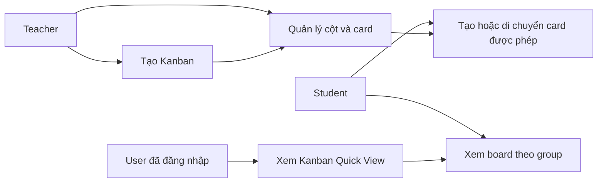
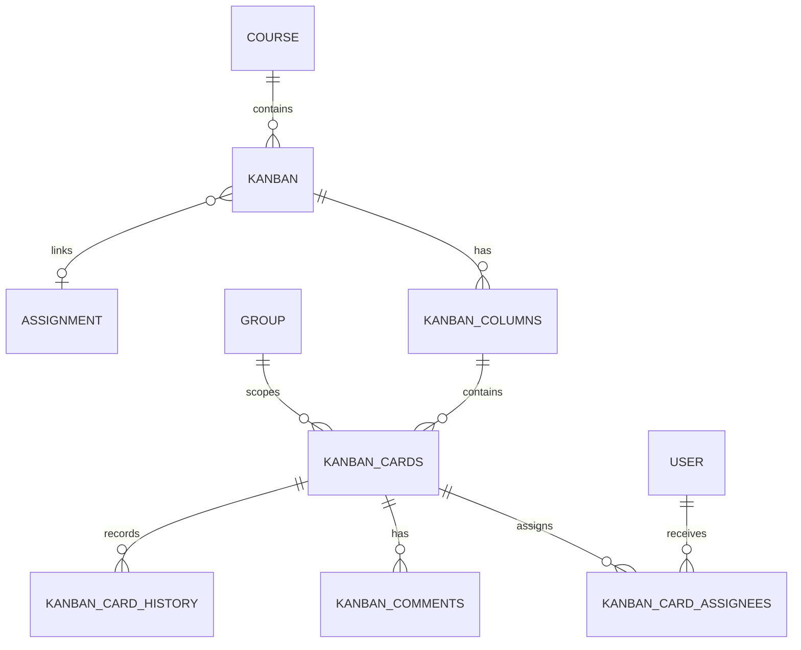

# Báo cáo kỹ thuật dự án Moodle Kanban

## 1. Phân tích yêu cầu và Use Case

### 1.1. Mục tiêu

Plugin `mod_kanban` hỗ trợ giảng viên và sinh viên quản lý công việc học tập theo bảng Kanban ngay trong Moodle. Plugin `block_buttonkb` bổ sung widget **Kanban Quick View** trên Dashboard, giúp người dùng xem nhanh số task và deadline liên quan.

### 1.2. Tác nhân

| Tác nhân | Vai trò |
|---|---|
| Administrator/Manager | Cài plugin, cấu hình Moodle, cấp capability. |
| Teacher | Tạo activity Kanban, quản lý cột/card, xem dashboard/history. |
| Non-editing teacher | Xem dữ liệu theo capability được cấp, không mặc định quản lý. |
| Student | Xem/thao tác card của group được phép. |
| Guest | Không được truy cập dữ liệu Kanban cần đăng nhập. |

### 1.3. Use Case chính



Các yêu cầu chi tiết, luồng chính/ngoại lệ và ma trận truy vết được mô tả tại `docs/SRS.md`.

## 2. Thiết kế cơ sở dữ liệu

Plugin dùng Moodle DB API và XMLDB, vì vậy không hard-code tiền tố `mdl_`. Schema được khai báo trong `db/install.xml`; thay đổi schema phải đi qua `db/upgrade.php`.



| Nhóm bảng | Mục đích |
|---|---|
| `kanban` | Activity, course, creator và Assignment liên kết. |
| `kanban_columns` | Tên, màu, thứ tự, WIP limit. |
| `kanban_cards` | Công việc, mô tả, cột, group, deadline, URL, thứ tự. |
| `kanban_card_assignees` | Quan hệ nhiều-nhiều giữa card và user. |
| `kanban_comments` | Bình luận card. |
| `kanban_card_history` | Lịch sử tạo/sửa/di chuyển/xóa/bình luận. |

Database triển khai và nghiệm thu là **MariaDB 10.11** trong Docker. PostgreSQL không thuộc phạm vi đồ án hiện tại.

## 3. Bảo mật cơ bản

Moodle core chịu trách nhiệm đăng nhập, session và hash mật khẩu. Plugin Kanban không tự lưu tài khoản hoặc tự mã hóa mật khẩu.

| Kiểm soát | Cách áp dụng |
|---|---|
| Xác thực | Dùng `require_login()` của Moodle. |
| Phân quyền | Dùng context/capability như `mod/kanban:view`, `managecards`, `managecolumns`. |
| Group isolation | Server lọc và kiểm tra group trước khi trả/thay đổi card. |
| CSRF/API validation | External API kiểm tra request hợp lệ, sesskey/framework validation. |
| SQL injection | Dùng Moodle `$DB`, parameterized query, không ghép SQL từ input. |
| XSS | Render qua Mustache/Moodle output API; input phải được validate/sanitize. |
| Attachment | Lưu/tải qua Moodle File API và kiểm tra context/quyền group. |

Các kiểm thử bắt buộc gồm: URL/AJAX trực tiếp với card của group khác, title chứa script, input SQL-like, request thiếu sesskey và file của group khác.

## 4. UI/UX

### 4.1. Kanban Board

- Hiển thị cột theo thứ tự, số card và WIP.
- Card có title, assignee, deadline và thao tác xem/sửa/xóa theo quyền.
- Modal tạo/sửa card có title bắt buộc, description, deadline, assignee, URL và attachment.
- Board phải có trạng thái rỗng, thông báo lỗi rõ ràng và giữ vị trí card sau refresh.

### 4.2. Kanban Quick View

ButtonKB là nút nổi trên Dashboard/trang chủ. Khi mở, panel hiển thị:

1. Số Kanban task user có quyền thấy.
2. Số course user đã tham gia.
3. Tối đa ba deadline Assignment gần nhất liên kết với Kanban.
4. Link tới trang My courses.

Đã kiểm tra thực tế: sau khi tạo card demo gán cho Admin No1, widget hiển thị **Kanban tasks: 1** và **Courses joined: 1**.

## 5. Tài liệu

| Tài liệu | Mục đích |
|---|---|
| `docs/SRS.md` | Đặc tả yêu cầu theo IEEE 830/ISO 29148. |
| `docs/KE_HOACH_KIEM_THU_KANBAN.md` | Test case, smoke test, bug report và tự động hóa. |
| `README.md` | Hướng dẫn chức năng, cài đặt, backup/restore và phát triển Kanban. |
| `README-Docker.md` | Khởi động Moodle bằng Docker. |
| `docs/HUONG_DAN_KIEM_THU.md` | Hướng dẫn PHPUnit/Behat. |
| API docs | External services Kanban được khai báo tại `db/services.php`; nên duy trì mô tả request/response khi thêm service. |

## 6. Quản lý mã nguồn

- Mã nguồn phải được quản lý bằng Git/GitHub.
- Mỗi thay đổi phải có commit message rõ ràng, ví dụ: `fix: enforce WIP limit on card move`.
- Không commit `.env`, `config.php`, database dump thật, `moodledata`, log hoặc mật khẩu.
- Pull request/code review nên kiểm tra: capability/context, validation input, migration XMLDB, test PHPUnit/Behat và AMD build.
- Plugin dùng version trong `version.php`; thay đổi schema/capability phải tăng version và chạy Moodle upgrade.

## 7. Triển khai Docker

Môi trường Docker gồm:

```text
Moodle (PHP/Apache) ─┐
Cron Moodle          ├── MariaDB 10.11
Selenium Chrome (*) ─┘
```

`Selenium` chỉ chạy khi test Behat. `cron` chạy Moodle cron để xử lý notification nội bộ.

```powershell
git clone https://github.com/unknownavailible/docker_do_an_chuyen_nganh.git
cd docker_do_an_chuyen_nganh
Copy-Item .env.example .env
docker compose up -d --build
```

Sau lần chạy đầu, mở `http://localhost:8080`, hoàn thành Moodle installer và mở **Site administration → Notifications** để cài/cập nhật Kanban và ButtonKB.

Kiểm tra môi trường:

```powershell
docker compose ps
docker compose logs cron
```

Cron phải có log `Cron run completed correctly`.

## 8. Hiệu năng cơ bản

Các tối ưu hiện có và cần duy trì:

1. Chỉ truy vấn card/cột của Kanban hiện tại và group hiện tại.
2. Sắp xếp bằng `sortorder`, tránh tải toàn bộ dữ liệu site.
3. Dùng Moodle cache/runtime cache mặc định, không tự tạo cache không có invalidation.
4. File dùng File API thay vì đọc trực tiếp filesystem.
5. ButtonKB chỉ đếm card thuộc course user đã enrol và chỉ lấy tối đa ba deadline gần nhất.

Kiểm tra tải nhẹ trước nghiệm thu:

| Test | Dữ liệu | Tiêu chí |
|---|---|---|
| Tải board | 10 cột, 100 card | Không timeout; board hiển thị trong mục tiêu 2 giây ở môi trường local. |
| Di chuyển card | 3 user thao tác tuần tự | Không mất card/sai sortorder sau refresh. |
| Widget Dashboard | 5 course, nhiều card | Số card và course chính xác; panel mở ổn định. |
| Log | Chrome console + Docker/Moodle log | Không có PHP fatal hoặc JavaScript error mới. |

Kiểm thử tải 500 card/nhiều user đồng thời là hạng mục mở rộng, không phải tiêu chí bắt buộc của phạm vi hiện tại.

## 9. Bằng chứng kiểm thử hiện có

| Hạng mục | Kết quả |
|---|---|
| PHPUnit `mod_kanban_testsuite` | PASS — 20 tests, 100 assertions. |
| Behat `@mod_kanban` với Chrome/Selenium | PASS — 4 scenarios, 22 steps. |
| ButtonKB Dashboard | PASS — hiển thị task Kanban thực tế. |
| Docker MariaDB/Cron | PASS — database healthy, cron log hoàn tất đúng. |

## 10. Hạng mục bảo trì còn lại

1. Bổ sung Behat cho upload/download file, comment, Assignment và ButtonKB.
2. Chạy test thủ công HTTP multipart/download, backup/restore UI, Privacy UI và deadline notification thật.
3. Chạy load test nhẹ với 100 card trước khi nghiệm thu.
4. Cập nhật README/API docs mỗi khi thêm external service hoặc migration.
