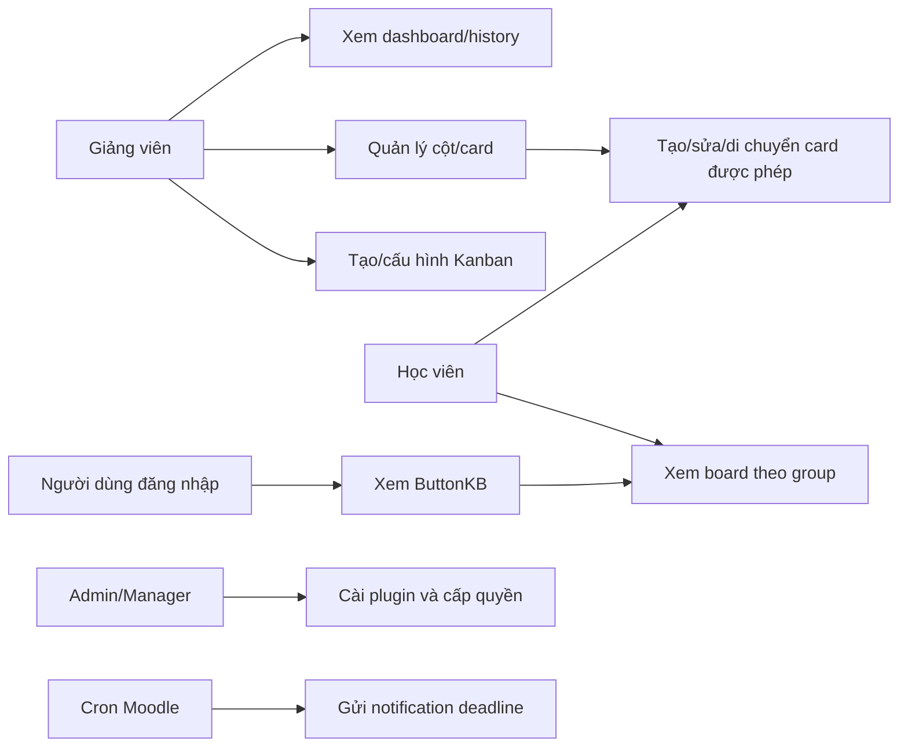
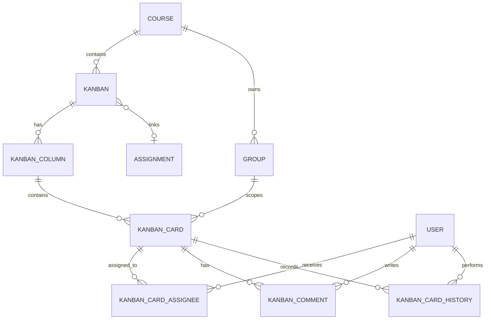

# Đặc tả yêu cầu phần mềm (SRS)

| Thuộc tính | Giá trị |
|---|---|
| Dự án | Moodle Kanban và Kanban Quick View (ButtonKB) |
| Phiên bản tài liệu | 1.0 |
| Ngày cập nhật | 07/11/2026 |
| Chuẩn tham chiếu | IEEE 830; ISO/IEC/IEEE 29148 |
| Nền tảng | Moodle Web Plugin |
| Trạng thái | Baseline cho đồ án |

## 1. Giới thiệu

### 1.1. Mục đích

Tài liệu này xác định yêu cầu nghiệp vụ, chức năng và phi chức năng cho hệ thống quản lý công việc theo Kanban tích hợp Moodle. Hệ thống gồm hoạt động `mod_kanban` trong course và block `block_buttonkb` (Kanban Quick View) trên Dashboard/trang chủ. Tài liệu là cơ sở để phát triển, kiểm thử, nghiệm thu và bảo trì.

### 1.2. Phạm vi

Hệ thống phải cho phép giảng viên và học viên quản lý công việc nhóm qua bảng gồm cột và card, giới hạn WIP, phân công, deadline, bình luận, file đính kèm, lịch sử và dashboard. Hệ thống phải sử dụng cơ chế xác thực, course, enrolment, group, capability, File API và Assignment sẵn có của Moodle. ButtonKB phải hiển thị tổng quan card và deadline cho người dùng đã đăng nhập.

Ngoài phạm vi: tạo hệ thống tài khoản riêng, thay đổi điểm/submission của Moodle Assignment, xử lý thanh toán, ứng dụng mobile độc lập và đồng bộ Kanban với dịch vụ bên thứ ba.

### 1.3. Định nghĩa và viết tắt

| Thuật ngữ | Diễn giải |
|---|---|
| Kanban | Hoạt động Moodle quản lý công việc bằng cột và card. |
| Card | Một công việc thuộc một cột Kanban. |
| WIP | Work In Progress; số card tối đa được phép trong cột của một nhóm. |
| CMID | ID course module, dùng để kiểm tra context và quyền Moodle. |
| Capability | Quyền Moodle kiểm soát thao tác người dùng. |
| ButtonKB | Block Kanban Quick View, hiển thị widget nổi trên Dashboard/trang chủ. |
| SRS | Software Requirements Specification. |

### 1.4. Tài liệu tham khảo

1. IEEE 830 và ISO/IEC/IEEE 29148.
2. Moodle Developer Documentation: Plugin API, External API, Groups API, File API, Backup API và Testing Tools.
3. Mã nguồn `mod/kanban`, `blocks/buttonkb` và đề cương đồ án.

## 2. Mô tả tổng quan

### 2.1. Bối cảnh sản phẩm

Kanban là activity plugin chạy bên trong Moodle, không phải một website độc lập. Moodle cung cấp đăng nhập, role, course, nhóm, assignment, database, File API và backup. Plugin chỉ bổ sung nghiệp vụ quản lý công việc. ButtonKB là block phụ thuộc vào `mod_kanban`, đọc dữ liệu Kanban để tạo tổng quan cá nhân.

### 2.2. Chức năng chính

1. Tạo và cấu hình activity Kanban trong course.
2. Quản lý cột, thứ tự cột và WIP limit.
3. Tạo, cập nhật, di chuyển, sắp xếp và xóa card.
4. Phân công nhiều người, áp dụng giới hạn group/capability.
5. Quản lý deadline, comment, URL và file đính kèm.
6. Theo dõi lịch sử, dashboard, deadline notification, backup/restore và Privacy API.
7. Hiển thị widget ButtonKB với số card, số course và deadline gần nhất.

### 2.3. Đặc điểm người dùng

| Vai trò | Mô tả | Quyền chính |
|---|---|---|
| Administrator/Manager | Quản trị Moodle và plugin | Cài đặt, cấu hình, cấp quyền, xem mọi dữ liệu theo capability. |
| Giảng viên | Tổ chức hoạt động trong course | Tạo Kanban, quản lý cột/card, xem dashboard/history, comment. |
| Học viên | Thành viên course/group | Xem và thao tác card thuộc group khi được cấp `managecards`. |
| Người dùng đã đăng nhập | Người có Dashboard | Xem ButtonKB và dữ liệu mà họ có quyền xem. |

### 2.4. Ràng buộc

1. Hệ thống phải tương thích Moodle 4.3.12 trong môi trường triển khai hiện tại; plugin Kanban yêu cầu Moodle 4.1 trở lên.
2. Runtime phải dùng PHP 8.2 và MariaDB 10.11 trong Docker hiện tại.
3. Mọi truy vấn database phải dùng Moodle `$DB` và XMLDB; không hard-code tiền tố `mdl_`.
4. File phải sử dụng Moodle File API, không đọc/ghi trực tiếp từ đường dẫn hệ điều hành.
5. Quyền phải được kiểm tra server-side; việc ẩn nút giao diện không được coi là kiểm soát truy cập.

### 2.5. Giả định và phụ thuộc

- Moodle, web server, database, cron và plugin dependency đã được cài hợp lệ.
- Người dùng được enrol vào course và có role/capability phù hợp.
- Với group mode, Moodle quản lý membership; Kanban không tự tạo hoặc sửa group.
- Notification deadline phụ thuộc cron Moodle chạy mỗi phút trong service Docker `cron`.
- ButtonKB phụ thuộc `mod_kanban` và phải được cài sau hoặc cùng Kanban.

## 3. Yêu cầu chức năng

### FR-01 — Tạo activity Kanban

| Thuộc tính | Nội dung |
|---|---|
| Mô tả | Hệ thống phải cho phép giảng viên tạo activity Kanban trong một course. |
| Tác nhân | Giảng viên, Manager, Administrator. |
| Điều kiện tiên quyết | Có quyền thêm activity vào course. |
| Luồng chính | 1) Chọn Add an activity. 2) Chọn Kanban. 3) Nhập tên, mô tả, group mode và Assignment liên kết tùy chọn. 4) Lưu. 5) Hệ thống tạo Kanban và các cột mặc định To Do, In Progress, Done. |
| Luồng thay thế | Nếu Assignment không thuộc course, hệ thống phải từ chối lưu và thông báo lỗi. |
| Kết quả | Một course module Kanban và các cột khởi tạo được tạo. |
| Ưu tiên | Must. |

### FR-02 — Xem bảng theo quyền và group

| Thuộc tính | Nội dung |
|---|---|
| Mô tả | Hệ thống phải chỉ hiển thị cột/card Kanban khi người dùng có `mod/kanban:view`; card group chỉ được trả về cho group hiện tại hoặc người có quyền xem tất cả group. |
| Tác nhân | Giảng viên, Học viên. |
| Điều kiện tiên quyết | Đã đăng nhập và được enrol vào course. |
| Luồng chính | Người dùng mở `view.php?id=<cmid>`; hệ thống kiểm tra login, context, capability và group trước khi render board. |
| Luồng thay thế | Người không có quyền hoặc thuộc nhiều group không hợp lệ phải nhận lỗi, không nhận dữ liệu card. |
| Kết quả | Board hợp lệ được hiển thị hoặc request bị từ chối. |
| Ưu tiên | Must. |

### FR-03 — Quản lý cột và WIP

| Thuộc tính | Nội dung |
|---|---|
| Mô tả | Hệ thống phải cho phép người có `managecolumns` tạo, sửa, sắp xếp và xóa cột rỗng; mỗi cột có màu, thứ tự và WIP limit không âm. |
| Tác nhân | Giảng viên, Manager, Administrator. |
| Điều kiện tiên quyết | Có activity Kanban và capability quản lý cột. |
| Luồng chính | Tạo/sửa cột; hệ thống kiểm tra dữ liệu, context và Kanban ownership; lưu thứ tự mới. |
| Luồng thay thế | Hệ thống phải từ chối xóa cột còn card hoặc cột cuối cùng. |
| Kết quả | Cột hợp lệ được cập nhật và board phản ánh thứ tự mới. |
| Ưu tiên | Must. |

### FR-04 — Tạo và cập nhật card

| Thuộc tính | Nội dung |
|---|---|
| Mô tả | Hệ thống phải cho phép người có `managecards` tạo/sửa card với tiêu đề, mô tả, deadline, URL, group và một hay nhiều assignee. |
| Tác nhân | Giảng viên, Học viên được cấp quyền. |
| Điều kiện tiên quyết | Có quyền thao tác card trong group hiện tại. |
| Luồng chính | Nhập dữ liệu card; hệ thống xác thực CMID, group, assignee, deadline và WIP; lưu card/assignee/history. |
| Luồng thay thế | Tiêu đề rỗng, deadline quá khứ, assignee ngoài group hoặc vượt WIP phải bị từ chối. |
| Kết quả | Card được lưu đúng cột/group và xuất hiện trên board. |
| Ưu tiên | Must. |

### FR-05 — Di chuyển và sắp xếp card

| Thuộc tính | Nội dung |
|---|---|
| Mô tả | Hệ thống phải cho phép kéo-thả card trong cùng cột hoặc sang cột khác, đồng thời kiểm tra quyền và WIP ở server. |
| Tác nhân | Người có `managecards`. |
| Điều kiện tiên quyết | Card và cột đích thuộc cùng Kanban; người dùng có quyền group. |
| Luồng chính | Client gọi external API; server xác thực card/cột/CMID/group, kiểm tra WIP, cập nhật `columnid` và `sortorder`, ghi history/event. |
| Luồng thay thế | Card group A được thao tác bởi group B hoặc WIP vượt limit phải bị từ chối. |
| Kết quả | Thứ tự/card được cập nhật nhất quán. |
| Ưu tiên | Must. |

### FR-06 — Comment, lịch sử và file đính kèm

| Thuộc tính | Nội dung |
|---|---|
| Mô tả | Hệ thống phải lưu comment/history card và cho phép upload, liệt kê, tải, xóa file theo Moodle File API. |
| Tác nhân | Giảng viên, người có quyền thao tác card. |
| Điều kiện tiên quyết | Người dùng có quyền card và context hợp lệ. |
| Luồng chính | Người dùng thêm comment/file; hệ thống xác thực quyền, lưu file tại `card_attachments`, ghi history. |
| Luồng thay thế | Người ngoài group hoặc không có capability phải không tải/xóa được file. |
| Kết quả | Dữ liệu card và audit trail được cập nhật. |
| Ưu tiên | Must. |

### FR-07 — Assignment, dashboard và notification

| Thuộc tính | Nội dung |
|---|---|
| Mô tả | Hệ thống phải hiển thị thông tin Assignment liên kết theo quyền Moodle, dashboard tiến độ và notification deadline khi cấu hình/cron hợp lệ. |
| Tác nhân | Giảng viên, Học viên, cron. |
| Điều kiện tiên quyết | Assignment cùng course được liên kết; cron Moodle đang chạy với notification. |
| Luồng chính | Kanban đọc tên/link/hạn nộp Assignment; scheduled task tìm deadline đủ điều kiện và gửi notification không trùng lặp. |
| Luồng thay thế | Assignment bị xóa/không thuộc course phải không được dùng làm liên kết. |
| Kết quả | Chỉ dữ liệu đọc được hiển thị; Kanban không sửa submission/grade/feedback. |
| Ưu tiên | Should. |

### FR-08 — Backup, restore và privacy

| Thuộc tính | Nội dung |
|---|---|
| Mô tả | Hệ thống phải backup/restore Kanban, cột, card, assignee, comment, history và attachment; phải hỗ trợ Moodle Privacy API. |
| Tác nhân | Giảng viên, Administrator, Data Protection Officer. |
| Điều kiện tiên quyết | Moodle Backup/Privacy services khả dụng. |
| Luồng chính | Moodle gọi plugin Backup/Restore hoặc Privacy API; plugin map lại ID/context hợp lệ. |
| Luồng thay thế | Mapping ID không hợp lệ phải dừng restore với lỗi kỹ thuật có thể truy vết. |
| Kết quả | Dữ liệu được khôi phục/xuất/xóa theo chính sách Moodle. |
| Ưu tiên | Should. |

### FR-09 — ButtonKB/Kanban Quick View

| Thuộc tính | Nội dung |
|---|---|
| Mô tả | ButtonKB phải hiển thị nút nổi trên Dashboard/trang chủ, mở panel số card Kanban người dùng thấy được, số course đã tham gia, tối đa ba deadline Assignment gần nhất và link My courses. |
| Tác nhân | Người dùng đã đăng nhập. |
| Điều kiện tiên quyết | `mod_kanban` và `block_buttonkb` đã cài; user có Dashboard. |
| Luồng chính | User bấm nút lịch; server tính card/course/deadline theo enrolment, group và assignee; panel được mở/đóng bằng AMD JavaScript. |
| Luồng thay thế | Guest hoặc user không có course phải nhận panel rỗng/an toàn; không lộ card/deadline ngoài quyền. |
| Kết quả | Tổng quan cá nhân được hiển thị. |
| Ưu tiên | Must. |

## 4. Yêu cầu phi chức năng

| Mã | Hạng mục | Yêu cầu đo lường được |
|---|---|---|
| NFR-01 | Hiệu năng | API tạo/di chuyển card phải phản hồi dưới 2 giây ở điều kiện phát triển với tối đa 100 card/board và 30 người dùng đồng thời. |
| NFR-02 | Bảo mật | 100% thao tác thay đổi card/cột/file phải kiểm tra login, context, capability, ownership và sesskey/API validation ở server. |
| NFR-03 | Phân tách dữ liệu | Request của user group B cho card group A phải trả lỗi truy cập; không được trả metadata/file của card. |
| NFR-04 | Độ tin cậy | Tạo/di chuyển card phải là giao dịch nhất quán: card không được tham chiếu cột/Kanban khác sau request thành công. |
| NFR-05 | Khả dụng | Docker Compose phải khởi động Moodle, MariaDB và service `cron` bằng `docker compose up -d`; database phải có healthcheck. |
| NFR-06 | Bảo trì | Mã PHP phải tuân Moodle API, không hard-code database prefix; thay đổi schema phải có XMLDB upgrade. |
| NFR-07 | Tương thích | Giao diện phải hoạt động trên Chrome/Edge bản hiện hành ở độ rộng desktop từ 1024 px; database nghiệm thu là MariaDB 10.11. PostgreSQL ngoài phạm vi. |
| NFR-08 | Kiểm thử | Suite PHPUnit Kanban phải đạt 20 tests/100 assertions; Behat Kanban phải đạt 4 scenarios/22 steps trên môi trường đã xác nhận. |
| NFR-09 | Sao lưu | Backup/restore không được làm mất quan hệ Kanban-column-card-assignee-comment-history-file. |
| NFR-10 | Quan sát | Các tạo/sửa/di chuyển/xóa card và comment phải ghi Moodle event/history có thời gian và user thực hiện. |

## 5. Yêu cầu giao diện và tích hợp

### 5.1. Giao diện người dùng

1. Board phải hiển thị cột theo `sortorder`, số card và trạng thái deadline.
2. Modal card phải có title bắt buộc, description, deadline, assignee nhiều lựa chọn, URL và attachment.
3. Các nút quản lý cột/card chỉ hiển thị cho user có capability tương ứng; server vẫn phải kiểm tra lại.
4. ButtonKB phải có nhãn truy cập được (`aria-label`), trạng thái mở/đóng và nút Close.
5. Chuỗi hiển thị phải dùng language pack tiếng Việt/Anh khi khả dụng.

### 5.2. Phần cứng và phần mềm

| Thành phần | Yêu cầu |
|---|---|
| Client | Trình duyệt Chrome/Edge hiện hành, kết nối mạng đến Moodle. |
| Server | Docker Desktop hoặc Apache/PHP tương thích; PHP 8.2. |
| Database | MariaDB 10.11 trong Docker hiện tại; thiết kế dùng Moodle DB API để hỗ trợ DB Moodle cho phép. |
| Test browser | Selenium standalone Chrome cho Behat. |

### 5.3. API và giao tiếp

| API/service | Mục đích | Điều kiện bảo vệ |
|---|---|---|
| `mod_kanban_create_card` | Tạo card | Login, context, capability, group, WIP, dữ liệu hợp lệ. |
| `mod_kanban_update_card` | Sửa card/assignee | Login, quyền card/group, validation. |
| `mod_kanban_move_card` | Kéo-thả card | Card/cột cùng Kanban, group, WIP, sortorder. |
| `mod_kanban_*comment*` | Comment/lịch sử | Quyền thao tác card. |
| `mod_kanban_*file*` | File attachment | Moodle File API, context và quyền group. |

## 6. Mô hình hóa

### 6.1. Use Case Diagram

### 6.2. ERD khái quát

## 7. Ma trận truy vết yêu cầu

| Yêu cầu | Thành phần chính | Xác minh |
|---|---|---|
| FR-01 | `mod_form.php`, `lib.php` | Manual: tạo activity và cột mặc định. |
| FR-02 | `view.php`, Groups API, capability | Behat group A/B; PHPUnit external tests. |
| FR-03 | `column_api.php` | PHPUnit: CRUD/sắp xếp/xóa cột. |
| FR-04 | `card_api.php`, AMD board | PHPUnit: tạo/sửa/assignee/WIP; manual modal. |
| FR-05 | `card_api.php`, `board.js` | PHPUnit + Behat WIP/di chuyển group. |
| FR-06 | File API, comment/history | PHPUnit file/privacy; manual HTTP upload/download còn cần thực hiện. |
| FR-07 | Assignment integration, scheduled task | PHPUnit deadline/Assignment; manual cron notification còn cần thực hiện. |
| FR-08 | `backup/moodle2`, privacy provider | Backup/restore và Privacy manual/CLI. |
| FR-09 | `block_buttonkb` | Manual Dashboard: panel hiển thị 1 task, 1 course. |
| NFR-08 | PHPUnit/Behat | Đã xác nhận: 20/20 PHPUnit, 4/4 Behat. |

## 8. Phụ lục

### 8.1. Trạng thái kiểm thử đã xác nhận

| Hạng mục | Kết quả |
|---|---|
| PHPUnit `mod_kanban_testsuite` | PASS — 20 tests, 100 assertions. |
| Behat `@mod_kanban`, profile Chrome/Selenium | PASS — 4 scenarios, 22 steps. |
| ButtonKB Dashboard | PASS — widget mở được, hiển thị 1 Kanban task và 1 course sau khi tạo card demo. |

### 8.2. Câu hỏi cần làm rõ

1. Học viên có được phép tạo card trong mọi course hay chỉ do giảng viên bật capability?

### 8.3. Rủi ro

| Rủi ro | Ảnh hưởng | Giảm thiểu |
|---|---|---|
| Cron không chạy | Không có notification deadline | Service Docker `cron` chạy mỗi phút; giám sát bằng `docker compose logs cron`. |
| Capability cấu hình sai | Lộ/thao tác nhầm card group | Kiểm thử role/group; giữ validation server-side. |
| Rebuild Docker không kèm plugin | Mất plugin ở image mới | Dockerfile phải copy `plugins/mod_kanban` và `plugins/block_buttonkb`. |
| Upload file lớn/không hợp lệ | Lỗi hoặc tiêu tốn storage | Dùng giới hạn Moodle, kiểm thử HTTP multipart. |
| Thiếu test UI mở rộng | Lỗi regression giao diện | Bổ sung Behat cho upload, comment, assignment và ButtonKB. |

### 8.4. Quyết định phạm vi đã chốt

1. Database nghiệm thu: chỉ MariaDB 10.11; PostgreSQL không thuộc phạm vi.
2. Thông báo: chỉ dùng notification nội bộ Moodle; không triển khai email hoặc mobile push.
3. ButtonKB: chỉ hiển thị trên Dashboard và Site home, không đặt trong course.
4. File đính kèm và history: giữ theo lifecycle mặc định Moodle; khi activity bị xóa, plugin xóa dữ liệu liên quan theo cơ chế Moodle.
